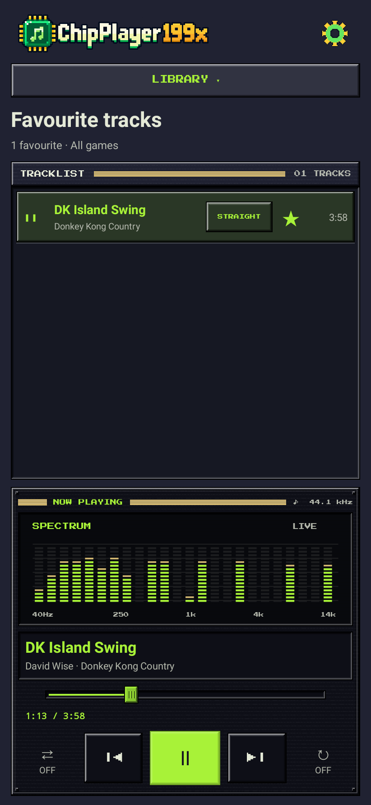
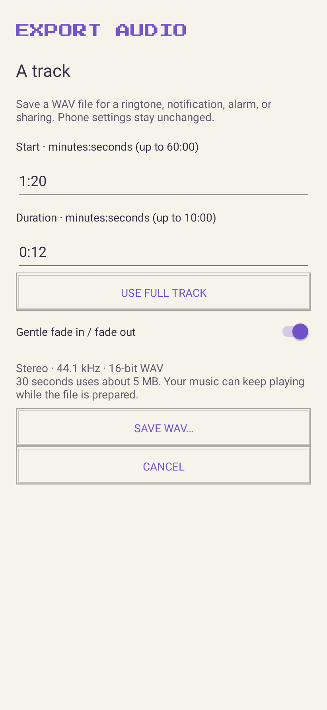
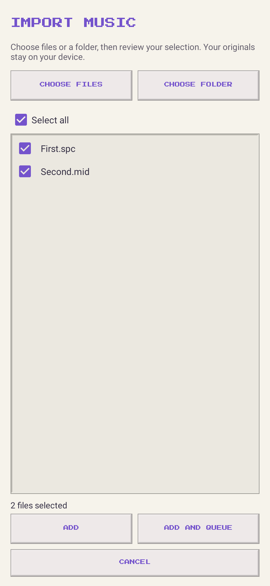
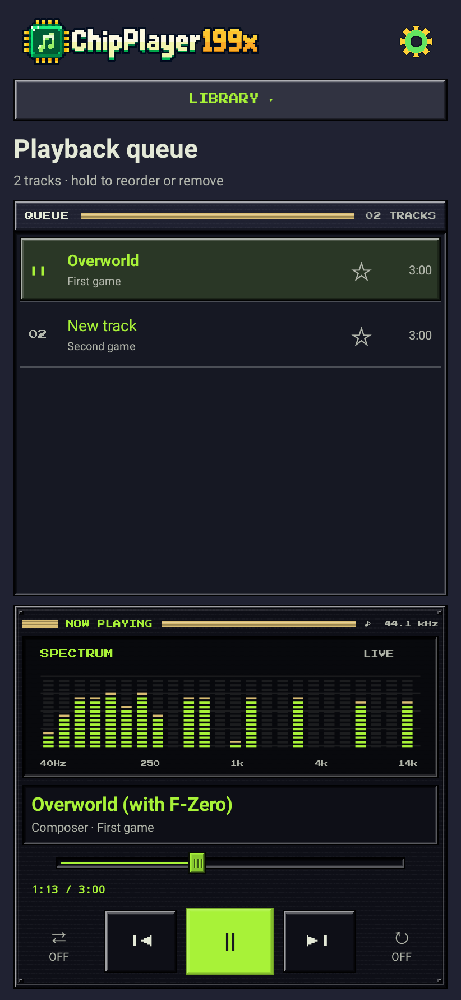
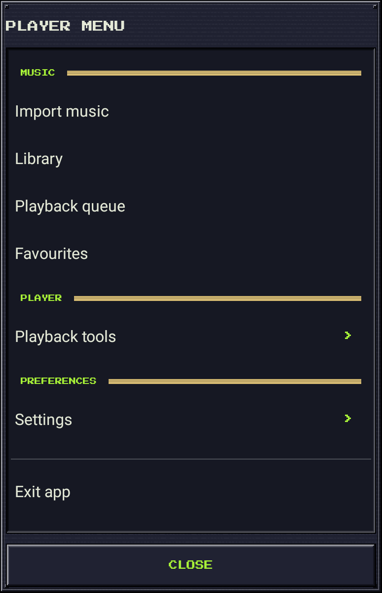
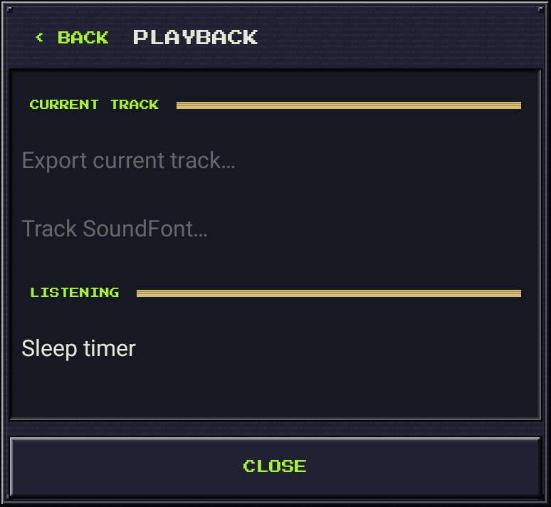

# ChipPlayer 199x

A pixel-styled Android player for retro game soundtracks, with ten themes,
favourites, WAV export, a sleep timer, and a home-screen widget.
Plays SPC/RSN, PlayStation PSF and MIDI with your choice of SoundFonts.

**[Download the Android APK](https://github.com/BaconBaps/androidsnesaudio/raw/refs/heads/main/downloads/ChipPlayer-199x-debug.apk)** · Android 8.0+ · 64-bit ARM

## The app

<table>
  <tr>
    <th>Llama</th>
    <th>Pixel Light</th>
  </tr>
  <tr>
    <td></td>
    <td></td>
  </tr>
  <tr>
    <th>Library</th>
    <th>Favourites</th>
  </tr>
  <tr>
    <td></td>
    <td></td>
  </tr>
  <tr>
    <th>Choose your theme</th>
    <th>Export audio</th>
  </tr>
  <tr>
    <td></td>
    <td></td>
  </tr>
  <tr>
    <th>Import music</th>
    <th>Playback queue</th>
  </tr>
  <tr>
    <td></td>
    <td></td>
  </tr>
  <tr>
    <th>Player menu</th>
    <th>Playback tools</th>
  </tr>
  <tr>
    <td></td>
    <td></td>
  </tr>
</table>

[See all ten themes](docs/THEMES.md) · [Try the original MIDI demo](downloads/ChipPlayer-MIDI-demo.mid).

## Home-screen widget

