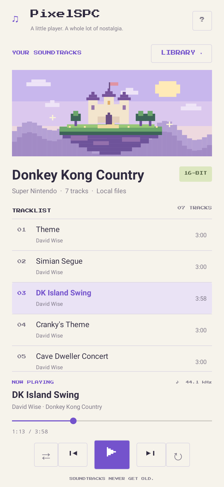

# PixelSPC

A small Android player for big retro soundtracks. Original pixel scenery,
lavender controls, and a local library for the games you grew up with.



## Install without Android Studio

Download [PixelSPC-debug.apk](downloads/PixelSPC-debug.apk) to your Android device,
open it, and allow installation from your browser or file manager when prompted.
Requires **Android 8.0 or later and a 64-bit ARM device** (x86-64 is also included
for emulators). This is a debug-signed development build, not a Play Store release.

Tap **Import music**, or **Library → Import another soundtrack**, and select your
file using Android's file picker. Tap a track to play. Use the fixed player panel
for pause, previous/next, seeking, shuffle, and repeat-one. Playback continues in
the background with notification and lock-screen controls. Headphone disconnect
pauses playback. Music is copied into the app's private storage and survives app
restarts; uninstalling removes imported files. Keep your original music files.

No music is bundled. Import your own files, including the example sets supplied
for development. The app requests no Internet or broad storage permission.

## Formats

| Files | Supported content |
| --- | --- |
| `.spc` | Super Nintendo tracks, including ID666 metadata |
| `.rsn`, `.rar` | RAR-based SPC sets (including solid RAR4 archives) |
| `.zip` | Sets containing supported tracks, including subfolders |
| `.nsf`, `.nsfe` | NES; each subsong becomes a selectable track |
| `.gbs` | Game Boy |
| `.vgm`, `.vgz`, `.gym` | Logged console/chip music supported by GME |
| `.hes`, `.kss`, `.ay`, `.sap` | Additional Game Music Emu formats |

ROMs (`.sfc`, `.smc`, etc.) are not audio files and are not supported. Encrypted
archives and RAR5 sets are not supported by this version of Junrar. Import limits:
128 MB input, 32 MB per extracted file, 256 MB total extraction, 1,000 songs.
Malformed or unsupported tracks roll back the entire import. Archive paths are
flattened so entries cannot write outside the library.

Track duration uses embedded timing when available, or two loops where tagged;
otherwise it defaults to 3 minutes. GME adds its ending fade. Auto-next wraps the
current set; repeat loops the selected song. There is no playlist editor, track
deletion, or configurable default duration in this first version.

## Build

No Android Studio is required. Install JDK 17 or 21 and Android command-line tools,
set `ANDROID_HOME`, accept SDK licenses, then run:

```sh
sdkmanager 'platforms;android-35' 'build-tools;35.0.0' 'ndk;27.2.12479018' 'cmake;3.22.1'
./gradlew --no-daemon assembleDebug testDebugUnitTest lintDebug
```

APK: `app/build/outputs/apk/debug/app-debug.apk`.

In the managed Linux cloud environment, `scripts/setup-cloud.sh` installs pinned
tools under `/workspace/tooling`, preserves certificate verification, and builds
and tests the project. Subsequent runs use `scripts/build.sh`. The script supplies
writable Android/Gradle caches and Java proxy/CA configuration. No separate Git
worktree is needed; use this isolated checkout.

GitHub Actions builds the APK and uploads it with reports after pushes to `main`,
pull requests, and manual runs. Open **Actions → Build Android APK → Artifacts**.
For Play Store distribution, use your own protected release signing key and a
release build; the included debug build is for development and sideloading.

## Validation and screenshots

Robolectric runs the Android 15 UI without an emulator. Tests cover empty-state
import/file-picker behavior, saved-library restoration, player progress layout,
service initialization, and archive handling. Native-graphics tests render
the screenshots in `docs/screenshots/`. Screenshots use a small metadata fixture
and a paused player state; they are **Robolectric renders, not device captures**.

The supplied Donkey Kong Country ZIP and Street Fighter II Turbo RSN were tested
separately: **29 + 36 SPC tracks** extracted, metadata read, and decoded to
non-silent 44.1 kHz stereo PCM through the same Java/JNI bridge and GME source used
by the Android app. Every track passed seeking and post-seek rendering. Corrupt
SPC/RSN, archive traversal, and oversized extraction checks also passed.

To reproduce sample tests on Linux with g++ and the SDK/JDK above:

```sh
scripts/test-samples.sh '/path/to/Donkey Kong Country (EMU).zophar.zip' /path/to/sf2t.rsn
```

This tests host-compiled native decoding, not physical-device sound output.
Device audio routing, Bluetooth, lock-screen controls, and background playback
still need a real-device listening pass. Additional console formats are enabled
in GME but have not been checked against user-supplied sample files.

## Implementation and licenses

Java Android views + original Canvas pixel art, an AudioTrack foreground service
with MediaSession controls, unmodified Game Music Emu linked as a shared library,
and Junrar for RSN extraction. See [THIRD_PARTY.md](THIRD_PARTY.md) for licenses,
source provenance, and rebuilding/replacing the LGPL decoder.
