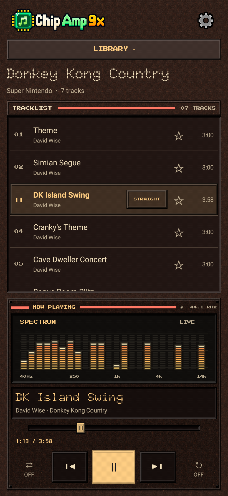
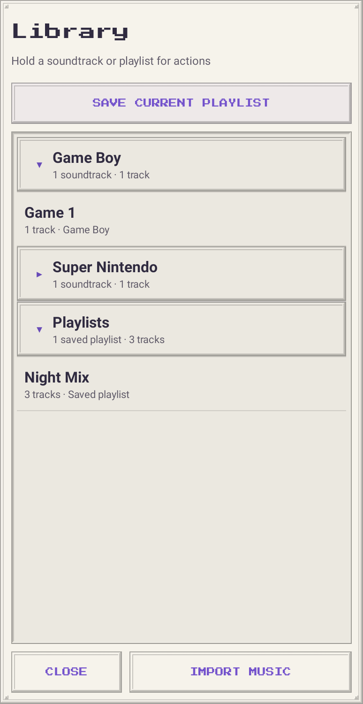
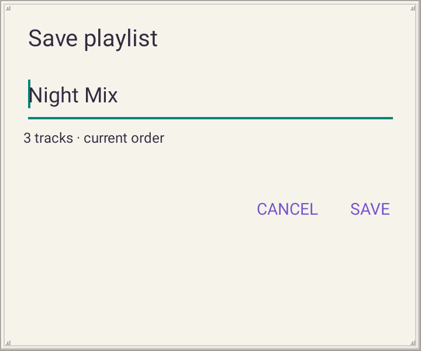
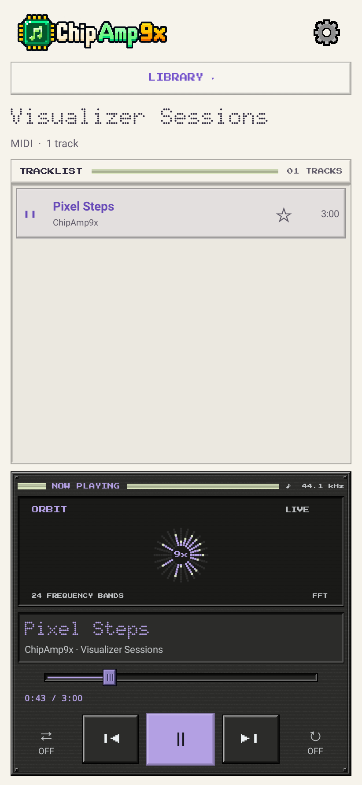
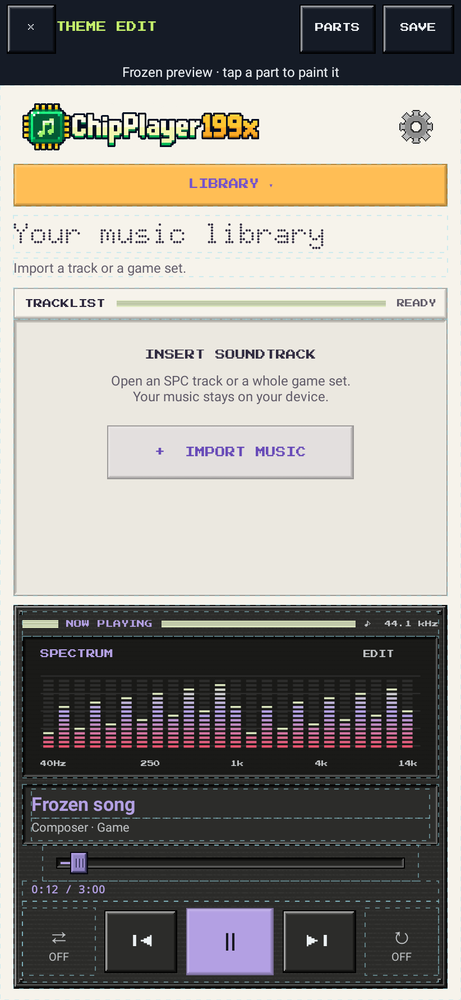
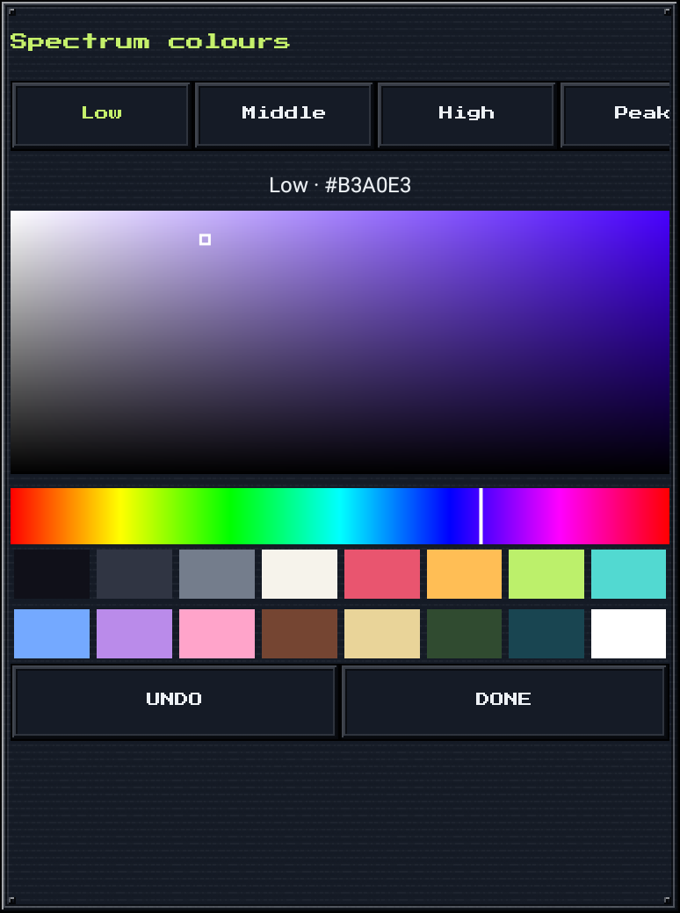

# ChipAmp9x

A pixel-styled Android player for retro game soundtracks, with eleven themes,
custom palettes, saved playlists, four audio visualizers, favourites, WAV export, a sleep timer,
and a home-screen widget.
Plays SPC/RSN, PlayStation PSF, Nintendo 64 USF and MIDI with your choice of SoundFonts.

**[Download the Android APK](https://github.com/BaconBaps/androidsnesaudio/raw/refs/heads/main/downloads/ChipAmp9x-debug.apk)** · Android 8.0+ · 64-bit ARM

## Supported files and platforms

| File type | Platform / content |
| --- | --- |
| `.spc` | Super Nintendo / Super Famicom |
| `.nsf`, `.nsfe` | NES / Famicom |
| `.gbs` | Game Boy / Game Boy Color |
| `.gym` | Sega Mega Drive / Genesis |
| `.vgm`, `.vgz` | Multiple systems, including Mega Drive / Genesis, Master System and Game Gear; playback depends on the sound chips used in the file |
| `.hes` | PC Engine / TurboGrafx-16 |
| `.kss` | MSX and some Master System / Game Gear music |
| `.ay` | ZX Spectrum / Amstrad CPC |
| `.sap` | Atari 8-bit computers |
| `.psf`, `.minipsf` | Original PlayStation |
| `.usf`, `.miniusf` | Nintendo 64 |
| `.mid`, `.midi` | Standard MIDI type 0/1 with PPQ timing, using the built-in or an imported SoundFont |

### Collections and supporting files

| File type | Purpose |
| --- | --- |
| `.rsn`, `.rar` | RAR-based soundtrack collections, commonly SNES SPC sets; includes solid RAR4 archives |
| `.zip` | Collections containing supported tracks, including subfolders |
| `.psflib`, `.usflib` | Shared dependencies for PlayStation / Nintendo 64 tracks; import alongside the tracks, preserving their folders |
| `.sf2` | SoundFont banks for MIDI playback, up to 64 MiB each |

Folders can also be imported. Extract `.7z` archives before importing; encrypted
archives and RAR5 archives are not supported. Shared library files and SoundFonts
are supporting files rather than standalone tracks.

PSF2 (`.psf2`, `.minipsf2`), console ROMs and general audio formats such as MP3
and FLAC are not currently supported.

## The app

**New: Reactor** — dithered rust-metal panels, recessed displays and glowing amber/red visualizers.

<table>
  <tr>
    <th>Llama</th>
    <th>Pixel Light</th>
  </tr>
  <tr>
    <td></td>
    <td></td>
  </tr>
  <tr>
    <th>Library</th>
    <th>Favourites</th>
  </tr>
  <tr>
    <td></td>
    <td></td>
  </tr>
  <tr><th>Saved playlists</th><th>Save your tracklist</th></tr>
  <tr>
    <td></td>
    <td></td>
  </tr>
  <tr>
    <th>Choose your theme</th>
    <th>Export audio</th>
  </tr>
  <tr>
    <td></td>
    <td></td>
  </tr>
  <tr>
    <th>Import music</th>
    <th>Playback queue</th>
  </tr>
  <tr>
    <td></td>
    <td></td>
  </tr>
  <tr><th>Waveform</th><th>Orbit</th></tr>
  <tr>
    <td></td>
    <td></td>
  </tr>
  <tr>
    <th>Player menu</th>
    <th>Playback tools</th>
  </tr>
  <tr>
    <td></td>
    <td></td>
  </tr>
  <tr>
    <th>Paint your theme</th>
    <th>Colour tools</th>
  </tr>
  <tr>
    <td></td>
    <td></td>
  </tr>
</table>

[See all eleven themes](docs/THEMES.md) · [Try the original MIDI demo](downloads/ChipAmp9x-MIDI-demo.mid).

## Home-screen widget

