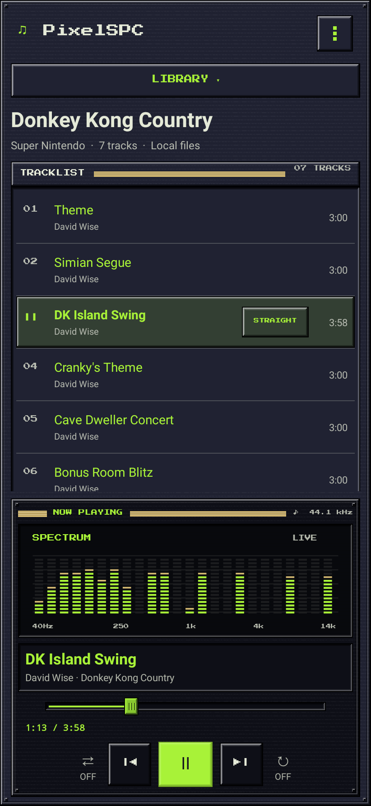
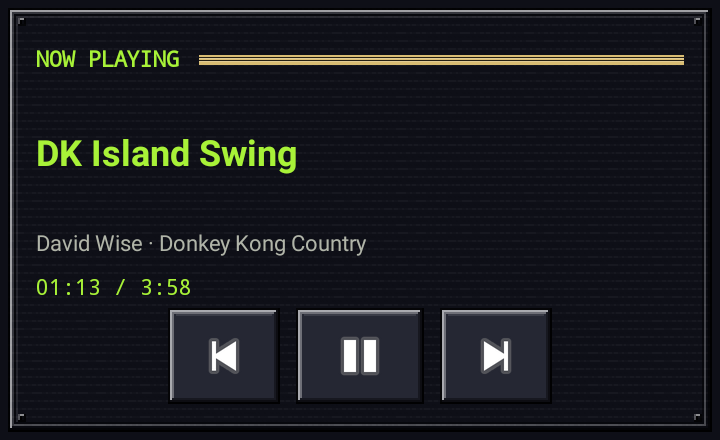

# ChipAmp9x

A small Android player for big retro soundtracks. A live pixel spectrum,
ten retro palettes, and a local library for the games you grew up with.



## Install without Android Studio

Download [ChipAmp9x-debug.apk](../downloads/ChipAmp9x-debug.apk) to your Android device,
open it, and allow installation from your browser or file manager when prompted.
Requires **Android 8.0 or later and a 64-bit ARM device** (x86-64 is also included
for emulators). This is a debug-signed development build, not a Play Store release.

Installing this update keeps your library,
favourites, and saved theme.

Tap **cog → Import music**, or **Library → Import music**, to open the themed
import screen. Choose files or a folder through Android's access picker, then
review the checked items and choose **Add** or **Add and queue**. **Cancel**
closes the review without copying anything. Tap a track to play. Use the fixed player panel
for pause, previous/next, seeking, shuffle, and continuous looping. The outer
buttons show ON/OFF states: left is Shuffle (changes the next track), right is
Loop (lets the current sound program keep running). These two controls are
borderless and show ON/OFF using text and accent color. Both preferences are saved.
Long track titles scroll smoothly to the end and back, pausing at each edge; this
works in the track list and Now Playing. The seek bar is inset from the panel edges.
VGZ/VGM seeking emulates the intervening chip audio, so long jumps can take a
moment. The time display shows **SEEKING → target** during this silent catch-up,
then audio resumes automatically if it was playing. Seeking while paused keeps
the player paused. Seeking runs in small steps: pause, another seek, or selecting another
track can interrupt it with Loop either on or off.
Playback continues in the background with notification and lock-screen controls. Headphone disconnect
pauses playback. Music is copied into the app's private storage and survives app
restarts; uninstalling removes imported files. Keep your original music files.

Open **Library** and hold a soundtrack to open **Play**, **Add to queue**, **Rename**, and
a separated **Delete** action. Choose **Delete** to remove that import and
its private music files after confirmation. Duplicate imports are separate entries;
your original files are kept. Deleting the queued soundtrack stops its playback.
The tracklist only shows a centered Import music button when empty. The larger
Library browser groups imports into collapsible platform sections, sorted by
platform and soundtrack name. It remembers which groups you expand or collapse.
Known metadata aliases (such as SNES and Super Famicom) share one group; mixed
archives appear under Multiple systems. Expand a platform to select or delete
a soundtrack.

The game title, metadata, Tracklist header, and outer tracklist edging stay fixed
while tracks scroll. The bottom border remains visible at every scroll position.
Theme selection, SoundFonts and About live in **cog → Settings**. The four light palettes use
softer frame shadows, while the playback deck keeps its dark finish.

Choose **cog → Exit app** or the notification’s pixel **× Exit app** action to stop playback, release the audio device, remove the
notification, and close the app’s task. Normal Home/Back navigation continues to
allow background playback. Android may cache the idle process after Exit, but the
playback service is stopped. Notifications use Android’s standard background with no custom color or artwork. Android controls the media notification layout; newer
versions expose Exit as a media-session action, and older compact notifications
show Play/Pause, Next, and Exit (Previous remains available when expanded).

No music is bundled. Import your own files, including the example sets supplied
for development. The app requests no Internet or broad storage permission.

## Export, favourites, and sleep timer

Long-press a track, or choose **cog → Playback tools → Export current track…**, to save audio as a
WAV file. Choose a start time and duration in `minutes:seconds`, optionally add a
short fade in/out, then choose the destination with Android’s Save picker. The
full-track shortcut uses the track’s tagged duration (or its default duration).
Exports are stereo 44.1 kHz, 16-bit PCM WAV, up to 10 minutes long with start
offsets up to 60 minutes. A 30-second clip uses about 5 MB. Rendering uses a
separate decoder, so playback can continue. Cancel stops preparation and attempts
to remove the empty destination; providers that refuse deletion may leave a file
to remove manually. No phone sound settings or extra permissions are needed.

Tap **☆** beside a track to favourite it. **cog → Favourites** collects starred
tracks across games; tap one to play the favourites queue. Stars survive app
restarts. Duplicate imports have independent favourites, and deleting an import
clears its stars. Choose a game from Library, or **cog → Back to soundtrack**, to
leave the favourites view.

**cog → Playback tools → Sleep timer** offers Off, 15, 30, 60, or 90 minutes. Playback pauses when
the timer expires, including with Loop on, keeping the track and position for
later. The menu shows the remaining minutes. The timer continues while using
other apps; Exit cancels it.

## Home-screen widget

Long-press your Android home screen, open **Widgets**, and add
**ChipAmp9x · Now Playing**. The resizable widget follows your selected
palette, with the player’s original nine-patch edging, title, artist/game,
elapsed clock and Previous / Play-Pause / Next controls. Tap the heading or track
name to open the app. When there is no loaded track, Play opens the app so you
can choose one. Exit clears the widget’s playback state.

The launcher runs the elapsed clock itself, without periodic background polling.
The live spectrum remains in the app. The widget controls the same queue,
shuffle and loop settings as the player; it does not start a separate decoder.



The header uses the selected green sound-chip logo, with a transparent background
and outlined lettering for light and dark palettes.

## Image-based player skin

The tracklist and platform accordion use dimmed, untextured surfaces, with
contrast-adjusted text. The Library button is slightly lighter, and section
labels are vertically centered with their rails.

The Library button and playlist sit above a separate, darker Now Playing deck.
Its spectrum sits above the track details and transport controls; the darker
palette adapts each theme’s accent to keep text readable. Header actions are collected in the single pixel-cog menu.

Original pixel PNGs give every theme raised metal borders, corner screws, inset
displays, metallic section rails, pressed controls, and a ridged seek thumb. Six
Android nine-patch images stretch the frames without stretching their corners.
Grain tiles independently; dark skins add subtle screen scanlines, while light
skins use quieter surfaces to preserve text contrast. The controls remain real
Android views with accessible labels, and shuffle/loop stay borderless.

Choose **Llama** at the top of the theme grid for midnight metal, phosphor
green and brass details inspired by late-90s desktop players. Existing theme
choices are preserved. [Skin assets and regeneration](SKIN.md).

## Themes

Choose **cog → Settings → Color theme** to choose a palette
from a grid of miniature player previews. The selected card has a checkmark. The choice is saved
between launches and updates the controls, dialogs, system-bar icons, and pixel
spectrum without interrupting playback. Choose Pixel Light, Pixel Dark, or one of
seven console-inspired palettes: SNES, Super Famicom, NES, Famicom, Game Boy,
Mega Drive / Genesis, and GameCube. Llama adds a classic PC look.
Six palettes use darker backgrounds; four retain light hardware-inspired
colors. Pixel Dark uses teal, Super Famicom navy/red, NES graphite, and GameCube rich violet. The spectrum uses each
theme’s accent and secondary colors.

[Browse all 10 theme screenshots](THEMES.md).

## Formats

| Files | Supported content |
| --- | --- |
| `.mid`, `.midi` | Standard MIDI type 0/1 with PPQ timing; built-in Pixel GM or imported `.sf2` banks |
| `.usf`, `.miniusf` | Nintendo 64 soundtracks; import shared `.usflib` files together in a ZIP or folder |
| `.psf`, `.minipsf` | Original PlayStation soundtracks; import shared `.psflib` files together in a ZIP |
| `.spc` | Super Nintendo tracks, including ID666 metadata |
| `.rsn`, `.rar` | RAR-based SPC sets (including solid RAR4 archives) |
| `.zip` | Sets containing supported tracks, including subfolders |
| `.nsf`, `.nsfe` | NES; each subsong becomes a selectable track |
| `.gbs` | Game Boy |
| `.vgm`, `.vgz`, `.gym` | Logged console/chip music supported by GME |
| `.hes`, `.kss`, `.ay`, `.sap` | Additional Game Music Emu formats |

ROMs (`.sfc`, `.smc`, etc.) are not audio files and are not supported. Encrypted
archives and RAR5 sets are not supported by the unarr RAR reader. Import limits:
128 MB input, 32 MB per extracted file, 256 MB total extraction, 1,000 songs.
Malformed or unsupported tracks roll back the entire import. Archive paths are
flattened so entries cannot write outside the library.

Track duration uses embedded timing when available, or two loops where tagged;
otherwise it defaults to 3 minutes. GME adds its ending fade. Auto-next wraps the
current set. With Loop enabled, the SPC emulator keeps executing the original
sound program: no timed fade, seek to zero, or audio-device restart occurs at the
musical loop boundary. This preserves natural SPC loops, rather than replaying
the introduction. One-shot tracks without a programmed loop can still become
silent. Loop cannot invent missing musical loop points.

An SPC with an explicit **xid6 loop-length tag (0x31)** also gets a **STRAIGHT /
LOOP** button in its track row. This saved per-track choice overrides the default
loop setting when the track starts. Straight uses its ordinary tagged duration
(or the fallback duration); Loop plays continuously. A total-duration or intro
length tag alone does not establish a loop, so untagged tracks only have the
bottom-right manual control. Existing imported SPC files are checked for tags
when an older library is loaded.

The graphic is a **24-band, logarithmic pixel spectrum** calculated from the actual
44.1 kHz stereo PCM using a Hann-windowed FFT. It handles either stereo channel,
including opposite-phase signals. Pixel peaks fall after sounds stop; pausing
settles the display. It never simulates activity when audio is silent and needs
no microphone or system-audio-capture permission.

Saved playlists can be loaded into the tracklist, played, or appended to the queue. Individual-song deletion and configurable default duration are not available yet.

## PlayStation PSF sets

Import a ZIP containing the `.psf` / `.minipsf` tracks and every referenced
`.psflib`, retaining the original folders. A self-contained `.psf` also imports
on its own. A miniPSF selected by itself cannot access sibling library documents;
use a complete ZIP set. Libraries are retained privately but hidden from the
track list. Metadata groups these soundtracks under PlayStation.

Original PlayStation **PSF version 1** is supported. PSF2 and PSP formats are not included. Nintendo 64 USF is supported separately. No BIOS is needed. PSF length/fade tags determine the
normal ending; absent length defaults to three minutes plus fade. Loop keeps the
emulated program running, and export uses an independent decoder. Long seeks
emulate the intervening audio, so catching up can take a moment.

This test build has native regression coverage with original generated MIPS/SPU
fixtures; compatibility with real game PSF drivers needs device/user testing.
The combined APK includes GPL-covered PSF code and is distributed under GPLv3;
the app's original source and artwork retain their MIT grant. See THIRD_PARTY.md
and COPYING-GPL-3 at the repository root for distribution terms and source.

## Build

No Android Studio is required. Install JDK 17 or 21 and Android command-line tools,
set `ANDROID_HOME`, accept SDK licenses, then run:

```sh
sdkmanager 'platforms;android-35' 'build-tools;35.0.0' 'ndk;27.2.12479018' 'cmake;3.22.1'
./gradlew --no-daemon assembleDebug testDebugUnitTest lintDebug
```

APK: `app/build/outputs/apk/debug/app-debug.apk`.

In the managed Linux cloud environment, `scripts/setup-cloud.sh` installs pinned
tools under `/workspace/tooling`, preserves certificate verification, and builds
and tests the project. Subsequent runs use `scripts/build.sh`. The script supplies
writable Android/Gradle caches and Java proxy/CA configuration. No separate Git
worktree is needed; use this isolated checkout.

GitHub Actions builds the APK and uploads it with reports after pushes to `main`,
pull requests, and manual runs. Open **Actions → Build Android APK → Artifacts**.
For Play Store distribution, use your own protected release signing key and a
release build; the included debug build is for development and sideloading.

## Validation and screenshots

Robolectric runs the Android 15 UI without an emulator. Tests cover empty-state
import/file-picker behavior, saved-library restoration, player progress layout,
service initialization, and archive handling. Native-graphics tests render
the screenshots in `docs/screenshots/`. Screenshots use a small metadata fixture
and paused/live service-state fixtures. Live-spectrum images feed synthetic
multitone PCM through the actual FFT. They are **Robolectric renders, not device
captures**.

The supplied Donkey Kong Country ZIP and Street Fighter II Turbo RSN were tested
separately: **29 + 36 SPC tracks** extracted, metadata read, and decoded to
non-silent 44.1 kHz stereo PCM through the same Java/JNI bridge and GME source used
by the Android app. Every track passed seeking and post-seek rendering. Corrupt
SPC/RSN, archive traversal, and oversized extraction checks also passed.

To reproduce sample tests on Linux with g++ and the SDK/JDK above:

```sh
scripts/test-samples.sh '/path/to/Donkey Kong Country (EMU).zophar.zip' /path/to/sf2t.rsn
```

This tests host-compiled native decoding, not physical-device sound output.
Device audio routing, Bluetooth, lock-screen controls, and background playback
still need a real-device listening pass. Additional console formats are enabled
in GME but have not been checked against user-supplied sample files.

## Implementation and licenses

Java Android views + Canvas pixel spectrum, an AudioTrack foreground service
with MediaSession controls, unmodified Game Music Emu linked as a shared library,
unarr for RSN extraction, and a BIOS-free Audio Overload/PeOPS PSF decoder. See [THIRD_PARTY.md](../THIRD_PARTY.md) for licenses,
source provenance, and rebuilding/replacing the LGPL decoder.

## MIDI and SoundFonts

Import `.mid` / `.midi` through **Import music**, individually or inside a ZIP/RSN.
The built-in **Pixel GM** bank provides an original, synthetic retro sound with
128 General MIDI program slots and percussion. It is about 27 kB, using simple
waveforms rather than recorded acoustic instruments. An original 16-second
[Pixel Steps MIDI demo](../downloads/ChipAmp9x-MIDI-demo.mid) is available to try.

Open **cog → Settings → SoundFonts** to import uncompressed `.sf2` banks, see
sizes, select a default, rename or delete imported banks. Files are copied once
into private storage. This version accepts banks up to **64 MiB** to keep mobile
memory use manageable; SF3, SFZ, DLS and compressed/archive banks are not supported.
Use an extracted `.sf2` file. The built-in bank remains available as a fallback.

Hold a MIDI track and choose **Choose SoundFont…**, or use **cog → Playback tools → Track SoundFont…**, to override the default for that track. Choose **Follow
default bank** to clear its override. Changing a bank restores the current track's
position and paused/playing state after seeking. Deleting a bank clears its
references; original source files remain untouched. WAV exports use the selected
bank in an independent synthesizer.

Playback supports tempo maps, running status, GM program/bank changes, velocity,
sustain, pan/volume/expression and pitch bend, with 128 synthesis voices. Standard
MIDI type 2, SMPTE timing and Doom MUS containers are not supported. SysEx and
pressure messages are not synthesized. This lightweight synth does not implement
every SF2 modulator/effect or vendor-specific GS/XG extension. Custom game banks
may need matching MIDI instrument mappings. MIDI Loop repeats the complete file
at its end marker; it does not infer game-specific loop markers. Straight playback
allows a two-second release/fade tail.

No Mario/Doom samples or other game-derived SoundFonts are bundled. User-imported
banks remain subject to their own licences.

## Import review and playback queue

The import window uses the selected app theme. **Choose files** supports multiple
selections; **Choose folder** lists supported files recursively with relative
paths. Uncheck **Include subfolders** to restrict music selection to the root.
Use the checkboxes or **Select all** to review the selection. Unsupported files
are omitted. Android still supplies the access-grant screen; the app does not
request broad storage access.

- **Cancel:** leave the review without importing.
- **Add:** copy selected music to the library, leaving playback and its queue alone.
- **Add and queue:** import and append the new tracks to the playback queue, then
  show that queue. The current decoder, position and playing/paused state remain.
  An empty queue is prepared without automatically playing; press Play to begin.

Loose files are imported together as a set, with archive files imported as their
own sets. Folder names are used when music metadata supplies no game name.
Relative PSF/USF paths are preserved and available `.psflib` / `.usflib` dependencies are copied
automatically when PSF/USF tracks are selected. They do not appear as playable tracks.
For direct file selection, choose the needed libraries too, or import the complete
PSF folder/ZIP. Sources are kept unchanged.

A review is limited to 1000 music files, 3000 folder entries, 16 directory levels,
128 MiB of selected source data, 256 MiB of stored extracted files and 1000 decoded
tracks. Existing per-file/archive limits still apply. Import work runs in the
background of the review screen and survives rotation. Once Add is pressed, the
screen finishes the import before closing. If a batch fails, previously added
sets from that batch are removed; pre-existing library entries stay intact.

Open **cog → Playback queue** to see tracks combined across imports. Hold an
entry to move it up/down, remove it, choose a MIDI bank or export audio. Removing
the current playing entry advances to the next remaining entry; removing it while
paused prepares the next entry without playing. Queue removal keeps the library
copy. Selecting a soundtrack/favourite track for playback replaces the queue as
before. The queue belongs to the running playback service; the library and
SoundFont assignments persist across app restarts.

For a MIDI track with an explicit bank assignment, the app's scrolling Now Playing
title shows **Track Name (with SoundFont Name)**. Bank renames update the displayed
name. Tracks following the default bank and other file formats keep their original
title; library metadata and exported filenames are unchanged.

## Library actions and playback controls

Tap a Library soundtrack to browse it. Hold its row to open a themed action menu:
**Play** starts its first track, **Add to queue** appends all its tracks without
interrupting current playback, **Rename** changes its saved library label, and
**Delete** removes its private library copy
after confirmation. Delete is separated from the other actions by extra space and
a divider. There is no longer a Delete button beside every Library entry.

Playback controls have larger touch areas and wider gaps, with a larger central
Play/Pause button. Widths and gaps adapt on narrow screens; Shuffle and Loop keep
their borderless appearance.

## Pixel cog and themed menu

The header menu is an original flat, transparent grey pixel cog. Its colours are
neutral greys, with no green or gold. It has no chrome button background or tint. Regenerate its
vector with `scripts/generate-menu-cog.py`.

The themed menu has pixel section headings, matching panel textures, colours and
focus/pressed states, with scrollable contents on smaller screens:

- **Music:** Import music, Library, Playback queue and Favourites.
- **Playback tools:** export the current track, its MIDI SoundFont assignment and
  the sleep timer. Track-specific actions are disabled when unavailable.
- **Settings:** colour theme, custom themes, SoundFont bank management and About/licences.
- **Exit app:** separated at the bottom of the main menu.

Submenus have a Back control; Android Back also returns to the main menu. Close
and an outside tap dismiss the menu. Existing playback continues during navigation.

## MIDI filenames and library labels

New `.mid` / `.midi` imports use the original filename without its extension as
the track title, including loose folder files and archive entries. Embedded MIDI
track-name events are ignored for display because they often name instruments
rather than songs. Explicit SoundFont suffixes still appear in Now Playing.
Older imports retain their saved titles; re-import their original files/sets to
use filename titles. Other music formats continue using their metadata titles.

Hold an entry in **Library** and choose **Rename**. Enter a non-blank name of up
to 80 characters and Save, or Cancel to keep the old name. This changes only that
library entry's label; track metadata, source files, private paths, favourites,
SoundFont assignments and playback queue are preserved. Delete remains separated
below Rename and still requires confirmation.

## Interactive custom themes

The Library window heading now uses the same pixel font as the Library button
and spectrum headings.

Open **cog → Settings → Color theme → Edit theme**, or **Custom themes → Create**.
The real interface becomes a **frozen preview**, labelled **Theme edit** with
outlined colour targets. Audio continues playing. Existing palette files and
preferences are unchanged until you Save; **×** or Android Back cancels the draft
and returns to the current live player. Edits and the frozen snapshot survive
rotation. When no audio spectrum is available, static example bars help preview
colours.

Tap a preview element to open its colour tools. **Parts** lists the available
areas if tapping a small target is difficult. Tabs choose properties such as
background, text, button face/label, headings and accents. The spectrum has low,
middle, high, peak and screen colours; choosing its range colours enables a
three-stop gradient. Use the colour square for saturation/brightness, drag the
hue strip, or tap a swatch. The swatch and colour readout respond immediately;
the app preview updates after a short drag pause. **Undo** restores the properties
to when that popup opened; **Done** returns to the frozen preview.

**Save** asks for a theme name. Editing a built-in creates an independent custom
palette; editing an existing saved theme updates it. Built-in themes remain
available. Custom themes appear in the normal preview grid and in **Saved themes**.
Tap a saved preview for **Use**, **Edit**, **Duplicate**, **Rename**, **Export** or
**Delete**. Deleting the active custom theme returns to its base palette.

Use **Import** in Saved themes to load a shared `.chiptheme.json` file. Export
uses Android's Save picker. Files contain only a version, name, built-in base and
opaque RGB colour roles; imports create independent copies rather than replacing
another theme. Up to 40 custom themes can be stored, with theme files limited to
64 KiB. The player, import/export screens and home-screen widget load the selected
custom palette. Decorative skin textures and logo artwork remain fixed.

Editor tools always use readable fixed colours, independently of the draft. If a
saved palette makes app text hard to see, **hold the grey cog** to open the fixed
Saved themes manager and choose or edit a palette. Colour choices are not blocked
by automatic contrast rules.

## Nintendo 64 USF sets

Import a ZIP or folder containing `.usf` / `.miniusf` tracks and all referenced
`.usflib` files, retaining the original folders. In the import review, available
libraries are included automatically with selected tracks and hidden from the
playlist. A self-contained `.usf` can be imported alone. Selecting a miniUSF
alone does not grant access to its sibling files; choose the full folder or ZIP.
N64 tracks appear under **Nintendo 64** in the library.

USF title/game/artist and length/fade tags are used. With no length tag the
default is three minutes plus a fade. Loop keeps the emulated program running
without a timed restart; a one-shot program may still fall silent. WAV export
uses its own decoder. Seeking replays the emulation and may take longer than
SPC; the existing **SEEKING** indicator and interruptible steps apply.

The portable LazyUSF2 decoder is built for ARM64 and x86_64 without a game ROM
or BIOS. Native tests use an original generated tone program; real game
compatibility, battery use and speed still need testing on an Android device.

In theme edit mode, only the first tracklist row is an edit target. Its colours
apply across the list. Highlights are clipped to the visible playlist, keeping
the Now Playing controls accessible.

N64 playback now uses an optimised decoder and a larger output buffer. It
briefly buffers at startup and after a playing seek to help smooth CPU spikes;
there may be a small delay before sound starts. Demanding game drivers may still
need testing on your phone.

## Hidden visualizer styles

Tap the display to cycle **Spectrum → Waveform → Stereo Scope → Orbit → Spectrum**.
Hold it to return directly to Spectrum. The chosen style is remembered after
restarting the app and changing themes. No menu or extra buttons are needed.

Waveform shows separate left/right traces from decoded PCM. Stereo Scope shows
the stereo phase relationship; mono audio forms a vertical line, while wider
stereo makes broader patterns. Orbit lays the 24 frequency bands around a ring.
All four use the selected theme colours, settle when paused and remain still in
theme edit mode. They use decoded music, with no microphone permission.

The launcher, header logo, widget, notification, export filenames and downloads
now use **ChipAmp9x**. The package identifier and signing key remain compatible
with existing installations, so this update retains your music and preferences.

## Saved playlists

Use **Save current playlist** in the player menu or library window to name and
save the tracklist currently on screen. This can be a soundtrack, favourites,
or your playback queue, including tracks from different games and repeated
tracks. Order is preserved. To build a mix, use **Add to queue**, open
**Playback queue**, reorder/remove entries by holding a row, then save it.

The library has a separate collapsible **Playlists** section. Tap a saved list
to browse/load it without changing playback, then tap a track to play from
that point. Hold the playlist for **Play**, **Add to queue**, **Rename** or
**Delete**. The last selected saved playlist is restored when reopening the app.
Saving under an existing name asks before replacing its contents.

Playlists store references, not copies of your audio. Deleting a saved playlist
keeps the music files and current playback queue. Removing an imported soundtrack
from the library makes its tracks unavailable in saved playlists; remaining
tracks keep their order, and an empty playlist can still be renamed or deleted.
Names may be up to 80 characters; up to 100 playlists of 1000 tracks can be saved.
