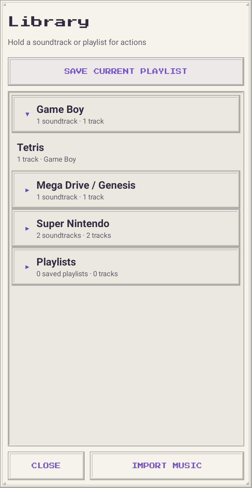

# ChipAmp9x raster chrome

The late-90s desktop-player feel is built from original PNG assets, rather than a
screenshot or a flat mockup. Text, spectrum bars and controls remain live Android
views. Llama adds midnight metal, phosphor green and brass; all existing
console palettes use the same skin geometry without changing saved theme IDs.


## Layout

The flat heading uses one raised 40 dp menu button, containing Import, Themes, About, and Exit. The Library button and
playlist come first. Now Playing uses a darker version of the selected palette,
with contrast-safe text/accent roles and its spectrum above the track readout.
The spectrum keeps its label proportions as the panel height changes.

The Library browser fills most of the screen. Its native ExpandableListView
keeps long collections scrollable, groups metadata aliases under their platform,
and remembers expansion state. Mixed-system imports stay together. Close and
Import remain at the bottom of the window.



## Assets

Nine sprite designs are generated at mdpi, hdpi, xhdpi, xxhdpi and xxxhdpi in `app/src/main/res/drawable-*/`:

| Image | Use |
| --- | --- |
| `skin_chassis.9.png` | Double metal edging and fixed corner screws |
| `skin_panel.9.png` | Raised panels and selected track |
| `skin_well.9.png` | Inset playlist, readout and spectrum |
| `skin_key.9.png` | Raised control |
| `skin_key_down.9.png` | Pressed control |
| `skin_rail.9.png` | Metallic title rails and seek fill |
| `skin_brushed.png` | Repeating brushed grain |
| `skin_scanlines.png` | Subtle repeating display scanlines on dark skins |
| `skin_thumb.png` | Ridged seek thumb |

The transparent centers let theme colors show through. Highlights and shadows
are raster pixels. Grain tiles independently of the frame, so widening a panel
does not enlarge its texture. Lighter chassis use highlight-only grain; lighter panels and selected rows
keep plain centers behind text to retain
contrast. The outer one-pixel borders of `.9.png` files are Android stretch/content
markers; AAPT2 compiles and removes them. Corners and screws stay outside the
stretch regions. Drawables use nearest-pixel sampling for the borders.

Regenerate the committed assets deterministically with Python 3, using only the
standard library. The generator scales the pixel art without interpolation and
rebuilds a one-pixel nine-patch metadata border at each density:

```sh
python3 scripts/generate-skin.py
scripts/build.sh
```

`PlayerSkin` combines the compiled nine-patches, theme-colored fills and repeating
textures. Each control gets its own drawable state; pressed/focused states do not
change layout size. Shuffle and loop retain their borderless appearance. Theme
previews use the actual frame assets. All artwork is original and MIT licensed;
no image files from the Winamp reference are used.

Robolectric renders the real view hierarchy for the screenshots. Tests check
compiled nine-patches, fixed corners at different sizes, pressed control states,
text contrast over actual textured pixels, and existing import/delete/exit flows.
These are UI renders, not captures from a physical Android device.

Light surfaces soften their nine-patch edges to 35% opacity; their original grain
and dark playback deck remain distinct. The notification uses the standard Android background without custom artwork
or colorization, and native media controls including an Exit action.
Android owns the final notification layout.

The main player and export screen use flat backgrounds without an outer frame.
Individual player controls, the submenu button, and the Now Playing deck retain
their detailed edging. Llama retains the stable `desktop-98` preference ID.

Track rows and accordion sections use a dimmed library palette without grain.
Muted text and accents retain at least 4.5:1 contrast. The Library button uses a
slightly lighter face. Pixel section labels omit extra font padding and center
vertically; their rows disable baseline alignment so divider rails share the
same center.

The home-screen widget uses native RemoteViews, tiled grain and compiled
nine-patch frames. It follows Now Playing’s dark palette, with track metadata,
a launcher-driven elapsed clock and three playback controls. It does not run an
animated spectrum or poll from a background timer.

The tracklist well belongs to a fixed outer frame. Only its inner content scrolls,
so the bottom and side edging stay visible at every playlist position.

The header and theme cards use the selected sound-chip logo A. Its transparent
PNG is fitted to the visible artwork bounds at draw time, preserving its aspect
ratio and crisp edges without stretching or recoloring it.

## Reactor hardware

Reactor adds its own six mechanical nine-patch frames, ordered-dither tile and
original generated rust-metal texture. Frames and dither are generated by the
same script at five densities. The full-resolution texture source stays in
`drawable-nodpi/reactor_metal.png`; Android decodes a small sampled copy once per
skin instance and tiles it at low opacity, avoiding full-size texture allocations
for each list entry. Display interiors use the tiny dither tile without the
metal artwork. Pressed controls retain a distinct recessed state.

The Reactor identity follows the built-in base ID through saved custom themes,
including JSON export/import. Spectrum and PCM traces receive layered pixel
halos without bitmap blur, off-screen buffers or extra animation timers. Decay,
pause, frozen theme editing and the existing four visualizer modes are retained.
No text, watermark or video controls from the reference are reproduced.

### v1.21.1 frame corrections

Removed isolated hatching and button-face dots from Reactor's stretchable regions.
Those details were becoming long copper bars and dark smears on wide controls.
Corner rivets remain in fixed regions; bevels and tiled grain remain intact.
Theme-grid names now use the player's section-heading pixel font at the same
7 sp size, independent of the thumbnail scaling, with up to two lines for names.

### v1.21.2 shared inset detailing

Reactor's app background retains its tiled rust texture and dithering without
an outer frame. The inset button faces and section-panel edging now apply to
all palettes, including custom themes. Light palettes retain their softened
frame shadows. Reactor keeps its own casing frames inside dialogs and the
Now Playing panel.
