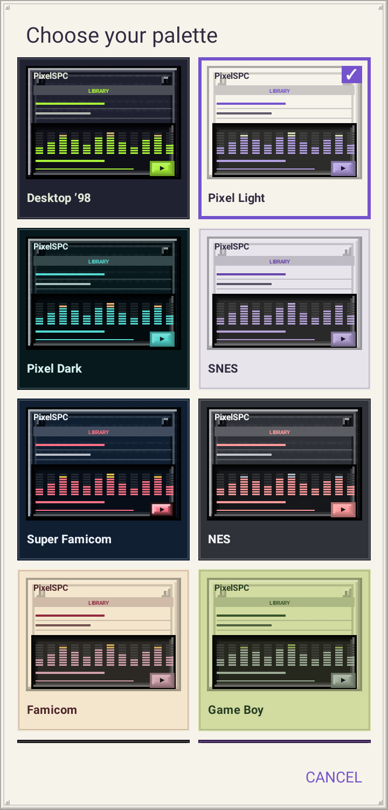
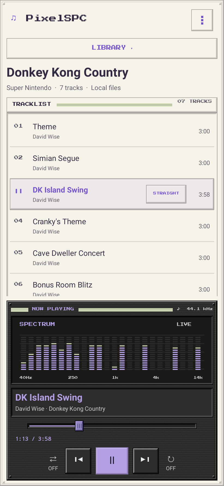
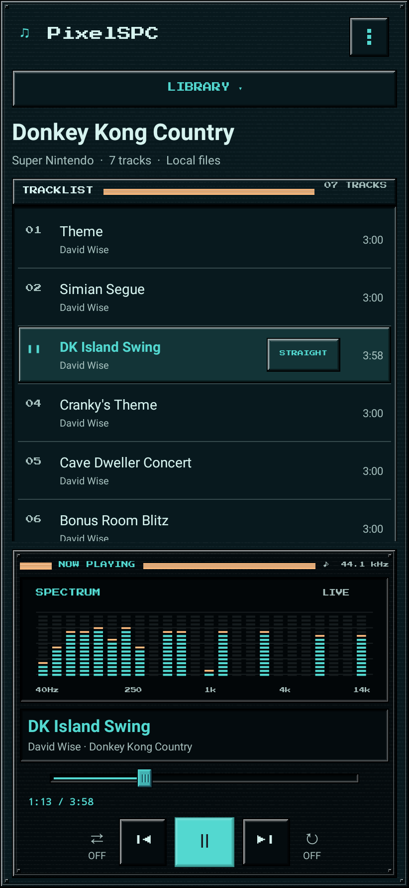
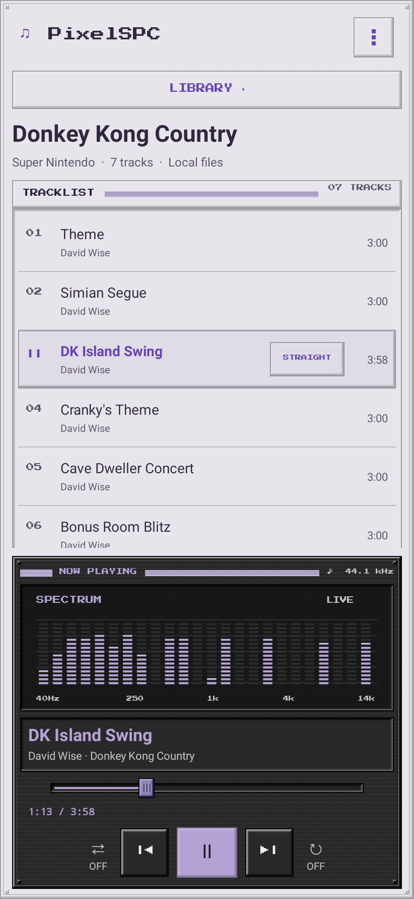
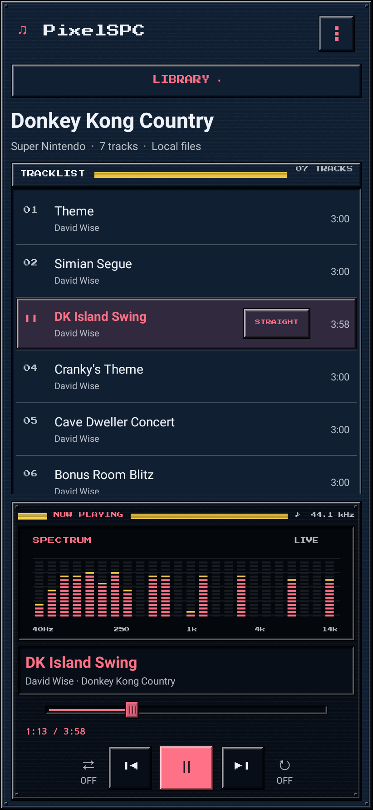
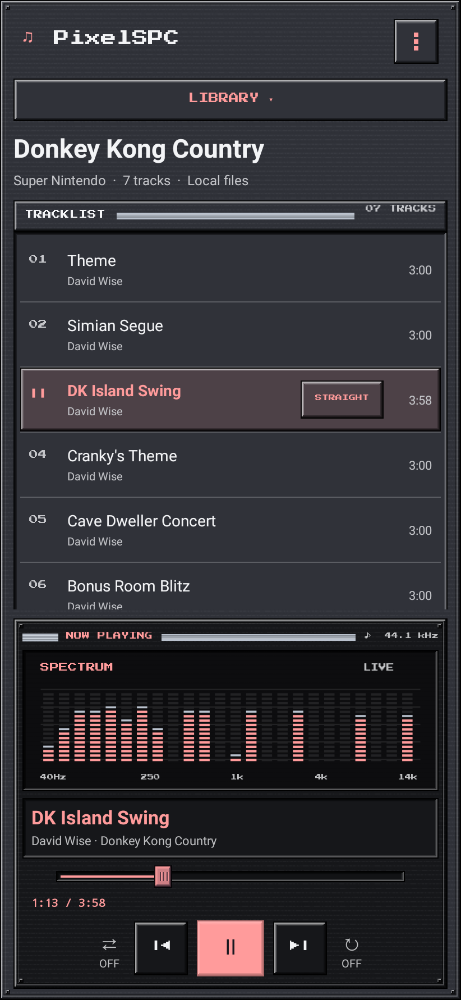
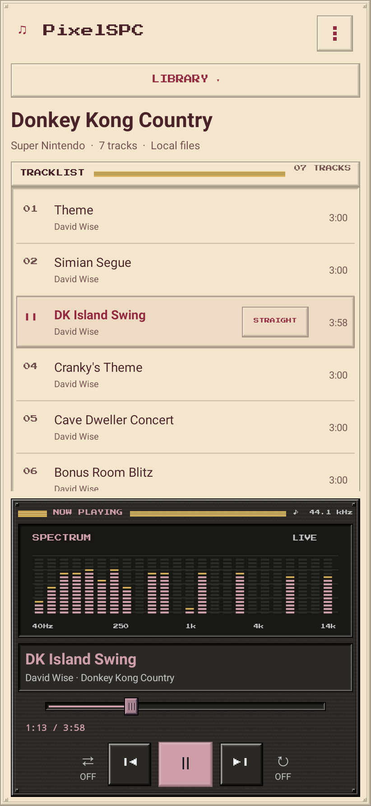
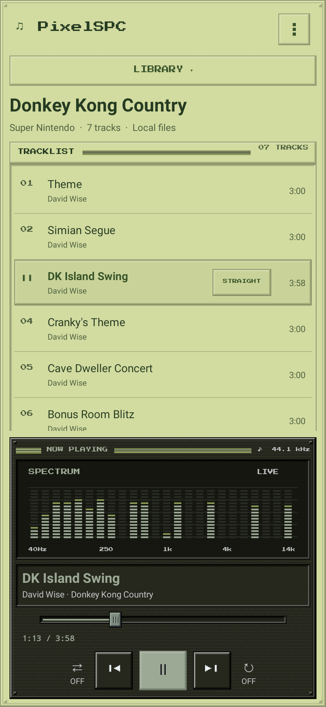
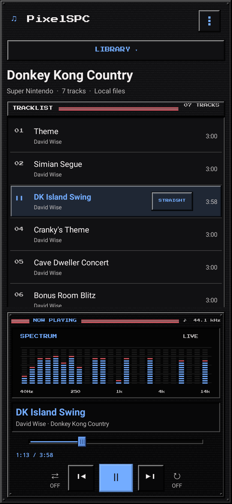
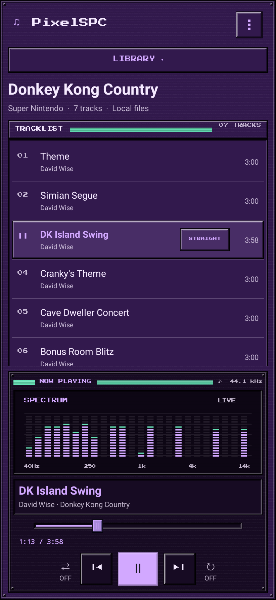

# Player themes

Choose a palette from the image-preview grid opened by **⋮ → Choose color theme**. Your selection is saved;
changing it keeps the current track and playback position. These original color
palettes draw inspiration from console hardware and logos; no console artwork or
logos are bundled.

Renders below come from the actual Android UI using Robolectric and a playback
metadata fixture with synthetic multitone PCM, rather than a physical device.
The pixel spectrum uses the selected palette’s accent and secondary colors. All
palettes share the original nine-patch metal frames and image-based controls;
dark palettes have stronger grain, and light ones keep quieter text surfaces.

## Desktop ’98

Midnight metal, phosphor green, and brass rails. Featured first in the picker.

## Pixel Light

Original lavender and cream.

## Pixel Dark

Deep ocean and electric teal.

## SNES

US hardware gray and purple.

## Super Famicom

Dark navy with red and gold button colors.

## NES

Graphite shell and cartridge red.

## Famicom

Ivory, burgundy, and gold.

## Game Boy

Four shades of the original LCD.

## Mega Drive / Genesis

Black hardware with Sega blue and red.

## GameCube

Deep violet shell and mint highlights.

