# Player themes

Choose a palette from the image-preview grid opened by **Header → Color theme**. Your selection is saved;
changing it keeps the current track and playback position. These original color
palettes draw inspiration from console hardware and logos; no console artwork or
logos are bundled.

Renders below come from the actual Android UI using Robolectric and a playback
metadata fixture with synthetic multitone PCM, rather than a physical device.
The pixel spectrum uses the selected palette’s accent and secondary colors. All
palettes share inset button and section-panel frames and image-based controls;
dark palettes have stronger grain, and light ones keep quieter text surfaces.

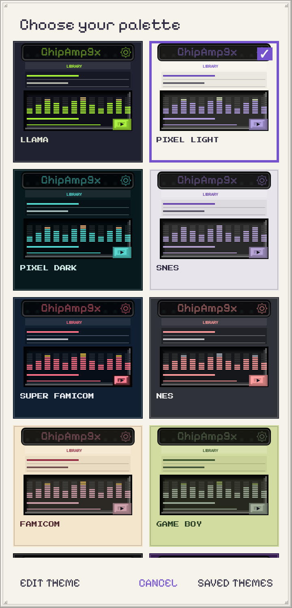

## Llama

Midnight metal, phosphor green, and brass rails. Featured first in the picker.

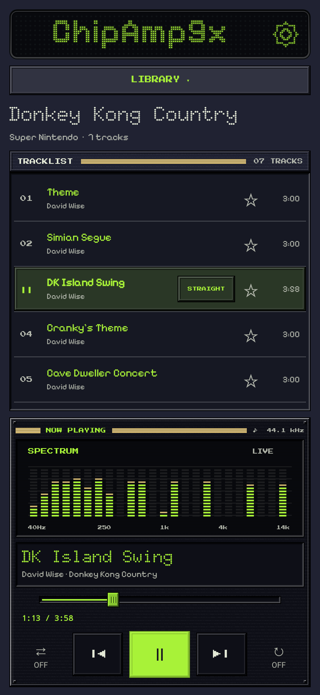

## Pixel Light

Original lavender and cream.

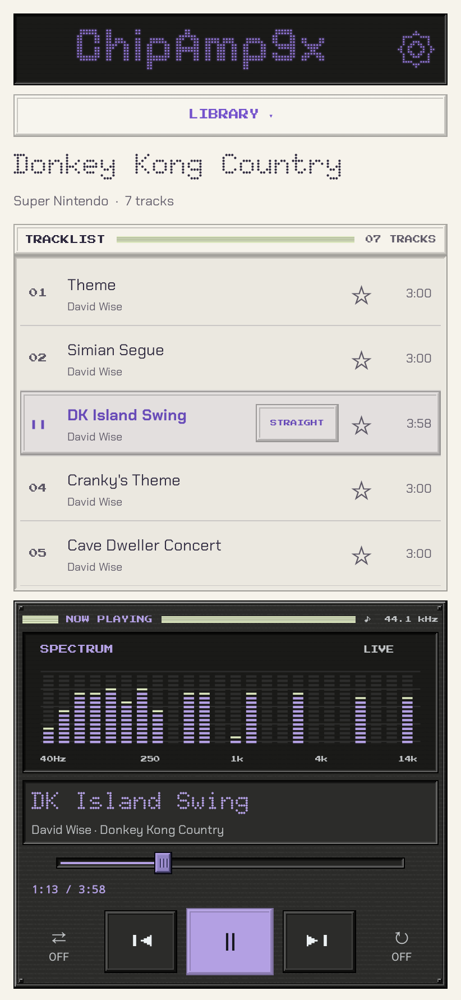

## Pixel Dark

Deep ocean and electric teal.

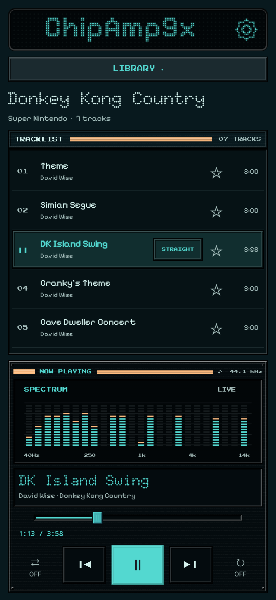

## SNES

US hardware gray and purple.

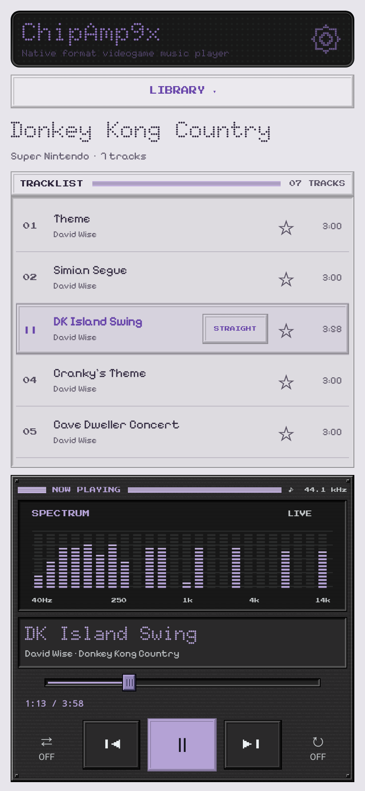

## Super Famicom

Dark navy with red and gold button colors.

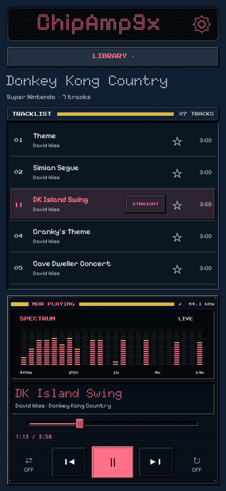

## NES

Graphite shell and cartridge red.

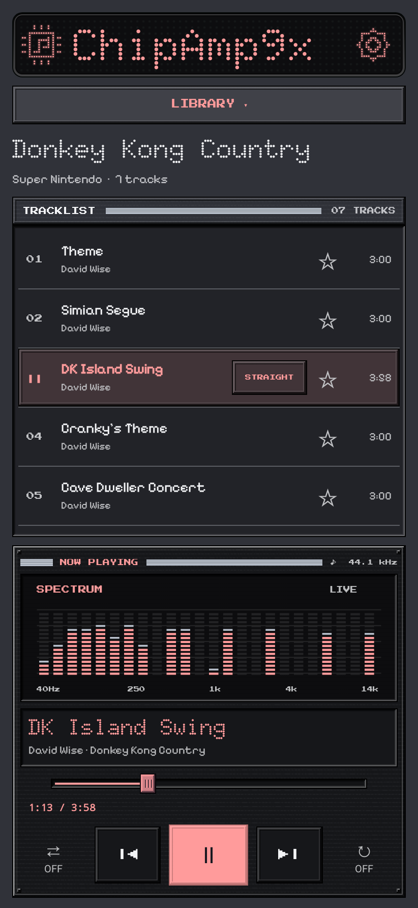

## Famicom

Ivory, burgundy, and gold.

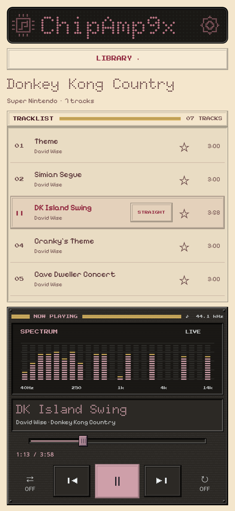

## Game Boy

Four shades of the original LCD.

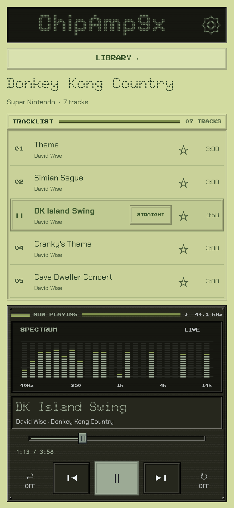

## Mega Drive / Genesis

Black hardware with Sega blue and red.

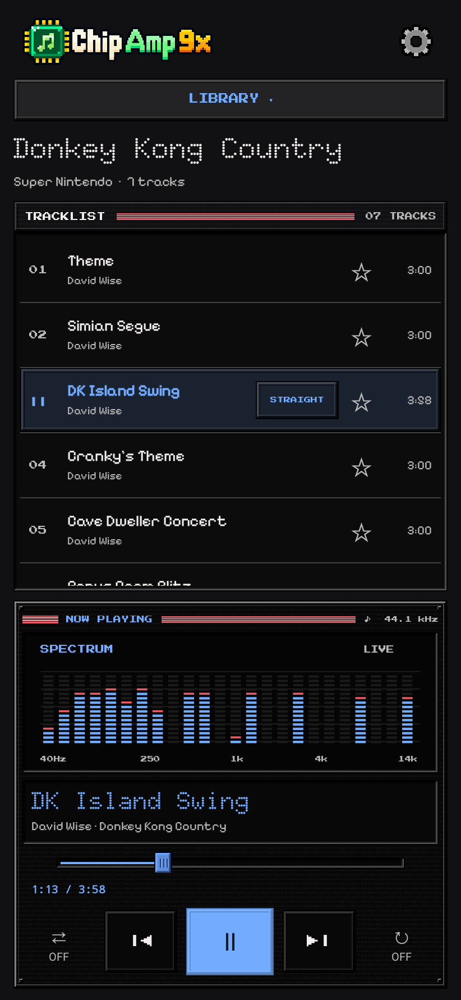

## GameCube

Deep violet shell and mint highlights.

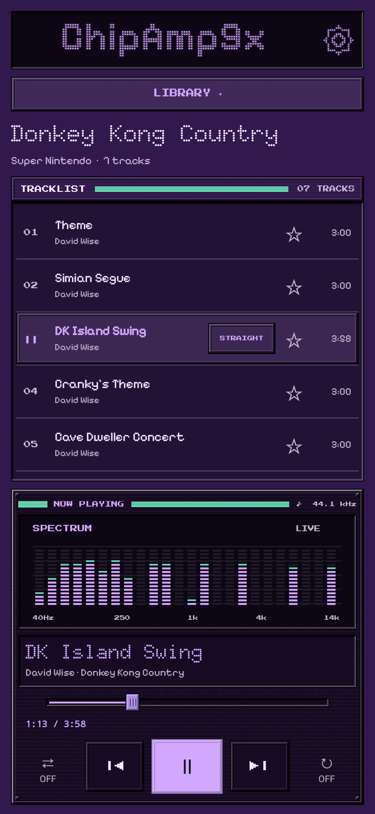

## ChipAmp5 style

Open **Header → Player style** to switch between Classic and ChipAmp5. Both offer
exactly the same ten palettes shown above. ChipAmp5 changes the geometry to
rounded plastic bezels and chunky controls; Classic keeps square header corners.
Colour selection and saved custom themes are shared across both styles.

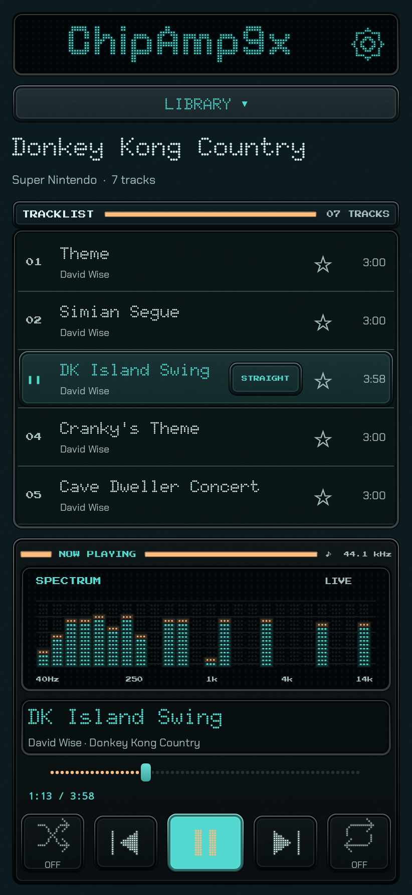
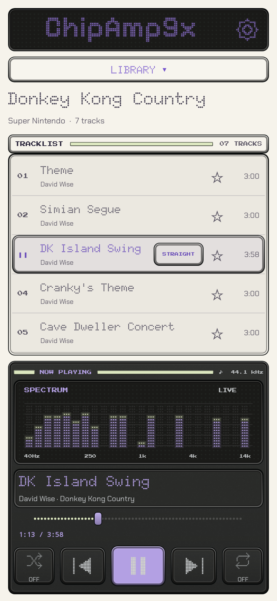

Chakra Petch is used for regular UI; Press Start 2P is used for small pixel labels. Doto track titles and Jersey 15
menu headings remain. The header rests most of the time, occasionally glitches,
scrolls down and returns letter by letter. Tap the header to open the Player menu.

The custom theme editor includes **Header display**: tap the header in the frozen
preview (or choose it in Parts) to adjust **Dots / cog** and **Screen** separately.
These colours save/export with the theme without changing the visualizer or main
accent. Existing themes retain their previous header appearance until edited.
