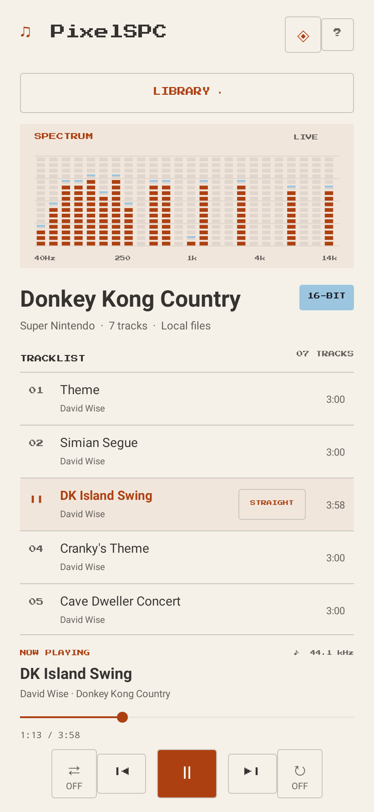
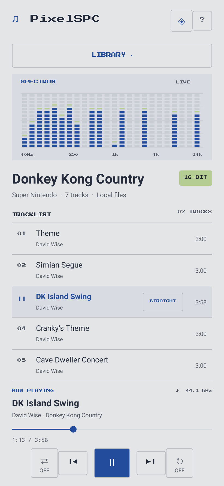
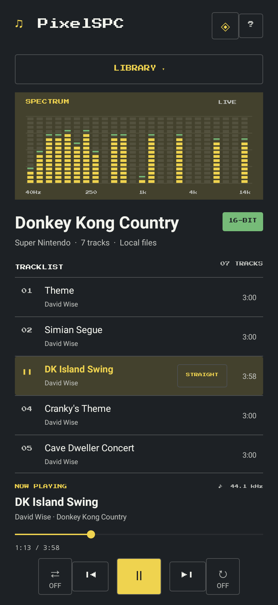

# Player themes

Choose a palette from the image-preview grid opened by the diamond button beside About. Your selection is saved;
changing it keeps the current track and playback position. These original color
palettes draw inspiration from console hardware and logos; no console artwork or
logos are bundled.

Renders below come from the actual Android UI using Robolectric and a playback
metadata fixture with synthetic multitone PCM, rather than a physical device.
The pixel spectrum uses the selected palette’s accent and secondary colors.

## Pixel Light

Original lavender and cream.

## Pixel Dark

Midnight ink and lavender.

## SNES

US hardware gray and purple.

## Super Famicom

Red, blue, green, and yellow buttons.

## NES

Light gray, charcoal, and red.

## Famicom

Ivory, burgundy, and gold.

## Game Boy

Four shades of the original LCD.

## Mega Drive / Genesis

Black hardware and red lettering.

## Dreamcast

Ivory hardware and orange spiral.

## PlayStation

Cool gray hardware and logo blue.

## Nintendo 64

Charcoal hardware and colorful logo.

## GameCube

Indigo hardware and lavender cube.

